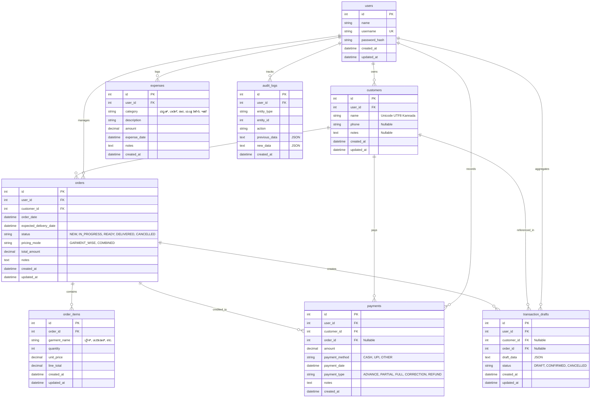

# Database Design: ನನ್ನ ಟೈಲರಿಂಗ್ ಖಾತೆ (My Tailoring Account Book)

## 1. Overview
The database architecture for "ನನ್ನ ಟೈಲರಿಂಗ್ ಖಾತೆ" is designed around relational integrity, precision financial accounting (using `DECIMAL(10, 2)` / `NUMBER(10, 2)`), full Kannada Unicode (UTF-8 / AL32UTF8), and non-destructive audit logs.

The schema natively supports **both MySQL 8.0 (Production / Cloud hosting)** and **Oracle SQL 21c (Local development)** via SQLAlchemy ORM and Alembic migrations.

---

## 2. Entity-Relationship Diagram

---

## 3. Table Details & Constraints

### 3.1 `users`
- `id`: `INTEGER`, Primary Key, Autoincrement
- `name`: `VARCHAR(100)`, NOT NULL
- `username`: `VARCHAR(100)`, UNIQUE, NOT NULL, Index
- `password_hash`: `VARCHAR(255)`, NOT NULL (Bcrypt hashed)
- `created_at`: `DATETIME / TIMESTAMP`, NOT NULL
- `updated_at`: `DATETIME / TIMESTAMP`, NOT NULL

### 3.2 `customers`
- `id`: `INTEGER`, Primary Key, Autoincrement
- `user_id`: `INTEGER`, Foreign Key references `users.id`, Index
- `name`: `VARCHAR(150)`, NOT NULL (Supports Kannada Unicode e.g. "ಲಕ್ಷ್ಮಿ", "ರಮ್ಯಾ")
- `phone`: `VARCHAR(30)`, NULLABLE, Index
- `notes`: `TEXT`, NULLABLE
- Composite Index: `(user_id, name)`

### 3.3 `orders`
- `id`: `INTEGER`, Primary Key, Autoincrement
- `user_id`: `INTEGER`, Foreign Key references `users.id`, Index
- `customer_id`: `INTEGER`, Foreign Key references `customers.id`, Index
- `order_date`: `DATETIME`, NOT NULL, Index
- `expected_delivery_date`: `DATETIME`, NULLABLE, Index
- `status`: `VARCHAR(50)`, NOT NULL (`NEW`, `IN_PROGRESS`, `READY`, `DELIVERED`, `CANCELLED`)
- `pricing_mode`: `VARCHAR(30)`, NOT NULL (`GARMENT_WISE`, `COMBINED`)
- `total_amount`: `DECIMAL(10, 2)`, NOT NULL, Default `0.00`
- `notes`: `TEXT`, NULLABLE
- Indexes: `(user_id, status)`, `(user_id, expected_delivery_date)`

### 3.4 `order_items`
- `id`: `INTEGER`, Primary Key, Autoincrement
- `order_id`: `INTEGER`, Foreign Key references `orders.id`, Index
- `garment_name`: `VARCHAR(100)`, NOT NULL
- `quantity`: `INTEGER`, NOT NULL, Default `1`
- `unit_price`: `DECIMAL(10, 2)`, NOT NULL, Default `0.00`
- `line_total`: `DECIMAL(10, 2)`, NOT NULL, Default `0.00`

### 3.5 `payments`
- `id`: `INTEGER`, Primary Key, Autoincrement
- `user_id`: `INTEGER`, Foreign Key references `users.id`, Index
- `customer_id`: `INTEGER`, Foreign Key references `customers.id`, Index
- `order_id`: `INTEGER`, Foreign Key references `orders.id`, NULLABLE, Index
- `amount`: `DECIMAL(10, 2)`, NOT NULL
- `payment_method`: `VARCHAR(50)`, NOT NULL (`CASH`, `UPI`, `OTHER`)
- `payment_date`: `DATETIME`, NOT NULL, Index
- `payment_type`: `VARCHAR(50)`, NOT NULL (`ADVANCE`, `PARTIAL`, `FULL`, `CORRECTION`, `REFUND`)
- `notes`: `TEXT`, NULLABLE
- `created_at`: `DATETIME`, NOT NULL

### 3.6 `expenses`
- `id`: `INTEGER`, Primary Key, Autoincrement
- `user_id`: `INTEGER`, Foreign Key references `users.id`, Index
- `category`: `VARCHAR(100)`, NOT NULL (`ವಿದ್ಯುತ್ ಬಿಲ್`, `ಅಂಗಡಿ ಬಾಡಿಗೆ`, `ದಾರ ಮತ್ತು ಸಾಮಗ್ರಿಗಳು`, `ಯಂತ್ರ ರಿಪೇರಿ & ಆಯಿಲಿಂಗ್`, `ಇತರೆ ಖರ್ಚುಗಳು`)
- `description`: `VARCHAR(255)`, NULLABLE
- `amount`: `DECIMAL(10, 2)`, NOT NULL
- `expense_date`: `DATETIME`, NOT NULL, Index
- `notes`: `TEXT`, NULLABLE

### 3.7 `transaction_drafts`
- `id`: `INTEGER`, Primary Key, Autoincrement
- `user_id`: `INTEGER`, Foreign Key references `users.id`, Index
- `customer_id`: `INTEGER`, Foreign Key references `customers.id`, NULLABLE
- `order_id`: `INTEGER`, Foreign Key references `orders.id`, NULLABLE
- `draft_data`: `TEXT` (JSON encoded draft containing multi-turn voice parsed items)
- `status`: `VARCHAR(50)`, NOT NULL (`DRAFT`, `CONFIRMED`, `CANCELLED`)

### 3.8 `audit_logs`
- `id`: `INTEGER`, Primary Key, Autoincrement
- `user_id`: `INTEGER`, Foreign Key references `users.id`, Index
- `entity_type`: `VARCHAR(50)`, NOT NULL (`customer`, `order`, `payment`, `expense`)
- `entity_id`: `INTEGER`, NOT NULL, Index
- `action`: `VARCHAR(50)`, NOT NULL (`CREATE`, `UPDATE`, `CORRECTION`, `REVERSAL`)
- `previous_data`: `TEXT` (JSON)
- `new_data`: `TEXT` (JSON)
- `created_at`: `DATETIME`, NOT NULL

---

## 4. Financial Calculations Formulae
1. **Order Remaining Balance**:  
   $$\text{Remaining Balance} = \text{Order Total Amount} - \sum(\text{Payments for Order})$$
2. **Customer Outstanding Balance**:  
   $$\text{Customer Balance} = \sum(\text{Active Orders Total}) - \sum(\text{Customer Payments})$$
3. **Net Cash Movement (Daily / Monthly)**:  
   $$\text{Net Cash} = \sum(\text{Actual Collected Payments}) - \sum(\text{Recorded Expenses})$$
*(Note: Net Cash Movement represents physical cash liquidity, strictly distinct from accrual accounting profit).*
